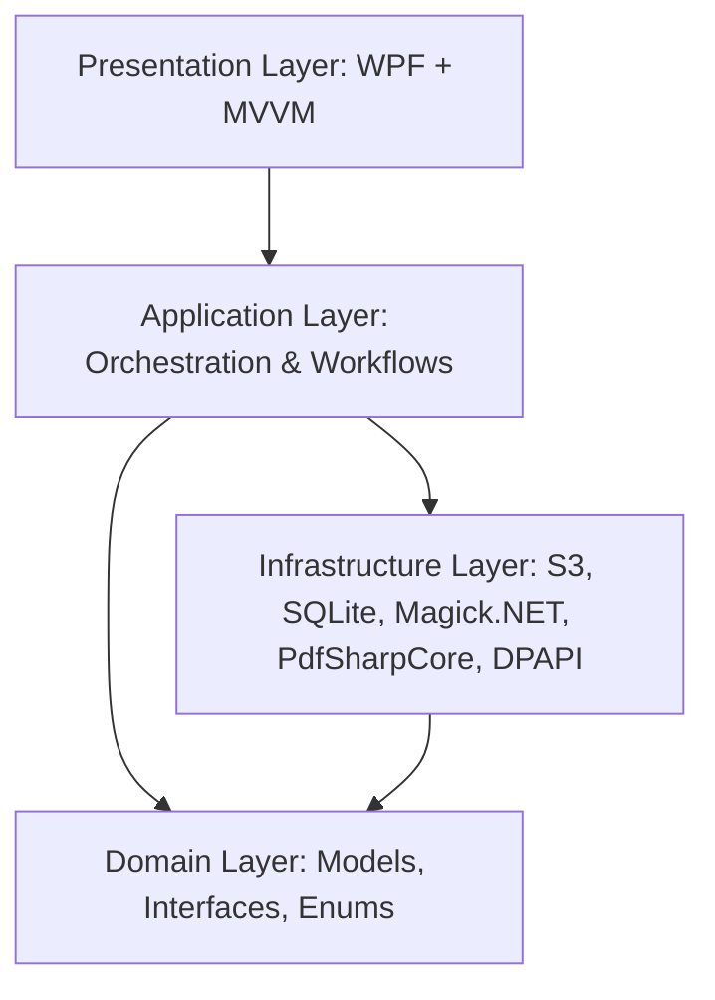
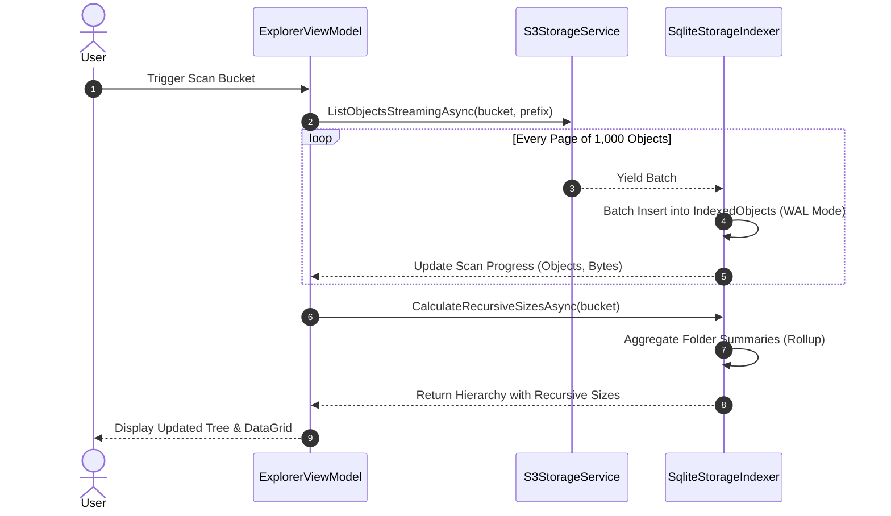
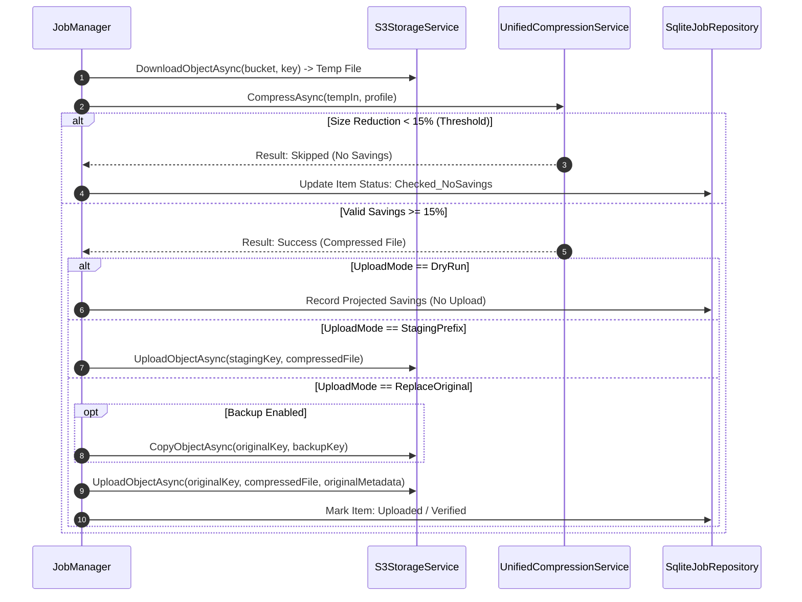

# SpacePilot — Architecture Specification

## 1. System Overview

**SpacePilot — S3 Storage Explorer & Smart Compressor** is an enterprise Windows desktop application designed to explore massive S3/DigitalOcean Spaces object storage buckets, calculate recursive folder hierarchies, safely clean up storage, and perform bulk image and PDF compression both locally and remotely in the cloud.

The application follows the principles of **Clean Architecture** with a strict separation of concerns:
- UI components and views do not perform file I/O or talk to cloud endpoints directly.
- All operations are asynchronous (`async`/`await`) with `CancellationToken` support, preventing any UI thread freezing.
- Storage indexing streams remote objects directly into local SQLite database pages rather than accumulating millions of objects in system RAM.

---

## 2. Layered Structure

### 2.1 Presentation Layer (`SpacePilot.App`)
- **Technology**: WPF targeting `net9.0-windows` with C# 13.
- **Pattern**: Model-View-ViewModel (MVVM) powered by `CommunityToolkit.Mvvm`.
- **Styling**: Modern Windows 11 Fluent-inspired theme system (`Themes/Colors.xaml`, `Themes/Styles.xaml`) with full dynamic Light and Dark mode switching.
- **Components**:
  - `MainViewModel` & `MainWindow`: Navigation host, status bar, and activity drawer.
  - `DashboardViewModel`: Storage metrics, recent jobs, storage distribution charts, and quick-action triggers.
  - `ExplorerViewModel`: Virtual folder tree, breadcrumb navigation, DataGrid file list, search, filters, and batch selection.
  - `CompressorViewModel`: Bulk image & PDF compression studio, side-by-side comparison with zoom/pan, quality profiles, and test file runner.
  - `LocalFilesViewModel`: Local directory processor with strict sibling `compressed/` output generation and directory isolation.
  - `CleanupViewModel`: Recursive folder size analyzer, largest file reports, duplicate file detection, trash staging, and bucket-confirmation delete safeguards.
  - `JobsViewModel`: Persistent background task monitor with Start, Pause, Resume, and Cancel capabilities.
  - `SettingsViewModel`: Connection profile manager with encrypted credentials, compression defaults, and theme controls.
  - `AboutViewModel`: Version telemetry, runtime details, and licensing credits.

### 2.2 Application Layer (`SpacePilot.Application`)
- **`JobManager`**: Thread-safe job scheduler managing active and pending jobs using `SemaphoreSlim` for bounded concurrency (default 4 workers) and `ManualResetEventSlim` for instant pause/resume gating.
- **`LocalFolderService`**: Discovers local files matching size and extension filters while strictly ignoring sibling `compressed/` subfolders to prevent recursion loops.
- **`UnifiedCompressionService`**: Coordinates input validation, pre-flight threshold checks (200 KB image, 300 KB PDF), engine dispatch, and savings verification (15% default threshold).

### 2.3 Domain Layer (`SpacePilot.Core`)
- **Models**: `StorageProfile`, `IndexedObject`, `FolderSummary`, `CompressionJob`, `JobItem`, `CompressionProfile`, `ApplicationSettings`.
- **Enums**: `StorageProviderType`, `QualityMode`, `ResizeMode`, `ImageFormatOption`, `MetadataPolicy`, `JobStatus`, `ItemProcessingStatus`, `UploadMode`.
- **Interfaces**: `IS3Service`, `IStorageIndexer`, `IUnifiedCompressionEngine`, `ISettingsRepository`, `IJobRepository`, `ILoggingService`, `ICredentialProtectionService`.
- **Utilities**: `ByteSizeFormatter` (IEC binary units), `PathUtilities` (safe prefix normalization).

### 2.4 Infrastructure Layer (`SpacePilot.Infrastructure`)
- **S3 / Cloud Storage**: `AWSSDK.S3` client wrapper with custom service URL support for DigitalOcean Spaces (e.g. `https://blr1.digitaloceanspaces.com`). Implements continuation-token pagination, exponential backoff retries with jitter, and remote metadata preservation (ContentType, Cache-Control, User Metadata).
- **Persistence (`SQLite`)**: `Microsoft.Data.Sqlite` configured in **WAL (Write-Ahead Logging)** mode for concurrent high-speed reads and writes. Uses streaming batch inserts (`500` items per transaction) to handle buckets with 1,000,000+ objects without memory pressure.
- **Image Processing**: `Magick.NET-Q8-AnyCPU` (ImageMagick) engine supporting lossless optimization, WebP/JPEG/PNG re-encoding, EXIF auto-orientation, transparency preservation, and bounded target-size binary search.
- **PDF Optimization**: `PdfSharpCore` (MIT licensed) structural stream compressor and object optimizer. Enforces page-count invariance checks and stream integrity validation without external native CLI dependencies.
- **Security**: Windows DPAPI (`ProtectedData.Protect` / `Unprotect`) using CurrentUser scope for S3 Secret Access Keys.
- **Logging**: Serilog rolling file provider with an in-memory event sink for real-time UI activity stream updates.

---

## 3. Key Workflows & Data Flows

### 3.1 S3 Bucket Exploration & Recursive Rollup Calculation

### 3.2 S3 Safe Compression Pipeline

---

## 4. Performance & Scalability Guarantees

1. **Memory Ceiling**: S3 scanning streams directly into SQLite using paginated continuation tokens (1,000 keys per page). Even for buckets with over 1,000,000 objects, application working set remains low and constant.
2. **Database Concurrency**: WAL mode allows concurrent reads during batch indexing.
3. **Thread Safety**: All state-modifying operations inside `JobManager` are guarded by lock primitives and coordinated with asynchronous semaphores.
4. **Resiliency**: Network requests retry automatically up to 3 times with exponential backoff and jitter for transient 500/503 errors and socket timeouts.
